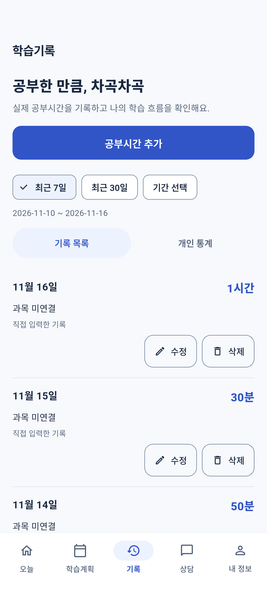
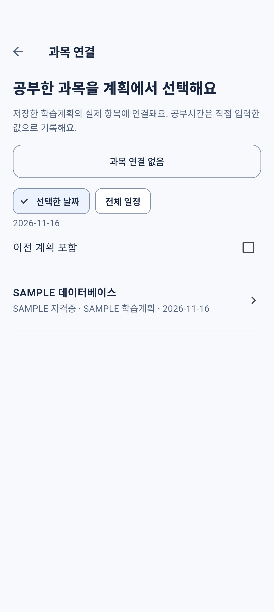
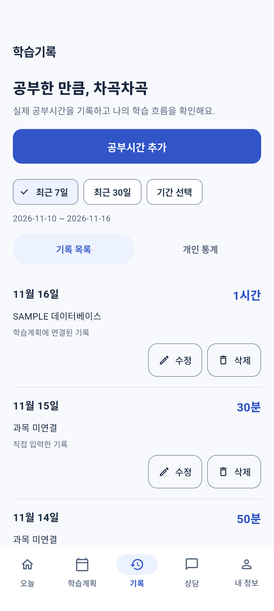
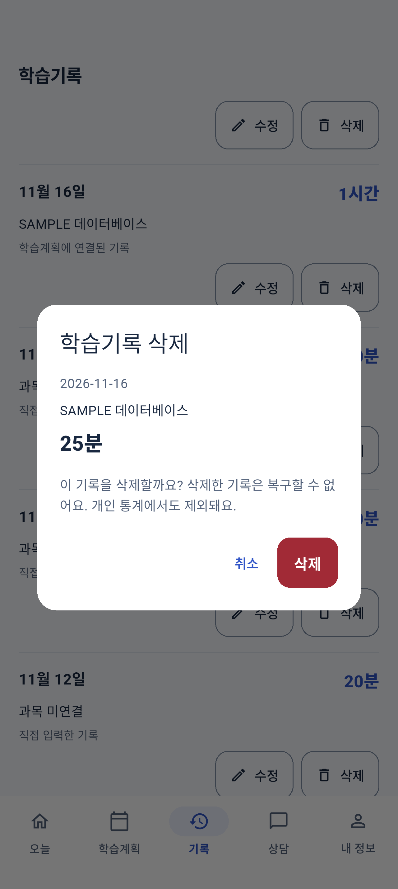
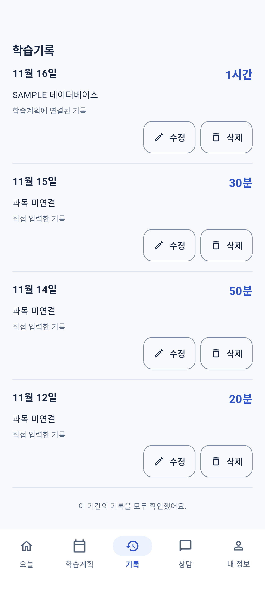
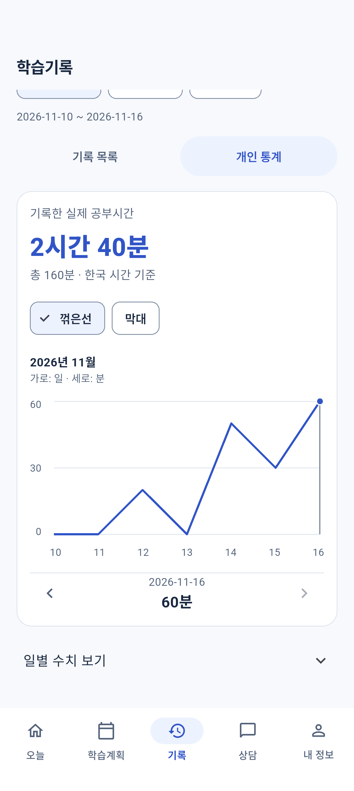

# 학습기록 삭제·과목 연결 검증

2026-11-16 · 담당 한결 · 기존 학습기록 Java6파일과 앱 범위

## 사용법과 원인

기록 목록에서 **삭제 → 확인창의 삭제**를 누른다. **취소**는 기록을 보존한다. 직접 입력한 기록만 삭제할 수 있고, 성공하면 기록과 개인 통계를 다시 조회한다.

기존 계획 조회 DTO에는 taskId가 없었고 앱의 수동 기록 요청도 날짜·분만 보냈다. 그래서 저장된 과목 연결 정보가 없었다. 다른 팀원의 계획 DTO를 고치지 않고 기존 학습기록 패키지에 **본인 계획 항목 조회**를 추가했다. 이름으로 ID를 추정하지 않는다.

추가·수정 화면의 **과목 연결 · 선택**에서 실제 저장된 계획 항목을 고른다. 기본은 선택한 날짜의 현재 계획이다. 없으면 **전체 일정**, 필요하면 **이전 계획 포함**을 확인한다. 계획이 없으면 연결 없이 기록한다. 기존 미연결 기록도 수정에서 연결할 수 있고, **과목 연결 없음**으로 해제할 수 있다. 선택해도 직접 입력한 실제 공부시간은 유지한다. 과목 레지스트리 ID가 null인 계획도 실제 taskId와 저장된 과목명으로 연결한다.

## API

[추가 API 전체6개와 입출력](../api-contract.md) · [OpenAPI](../study-api.openapi.json)

- 새 `DELETE /study/sessions/{sessionId}`: 본인·현재 전공·직접 입력 여부와 원래 날짜/분/과목 연결을 확인하고 해당 기록 한 행만 삭제한다.
- 새 `GET /study/plan-tasks`: 본인 ACTIVE 계획 항목을 반환한다. 날짜/전체 일정·이전 REPLACED 계획 포함·페이지 조회를 지원한다. DRAFT와 타인 항목은 제외한다.
- 기존 PATCH에 선택 항목 `taskLink`와 `expectedTask`를 추가했다. 기존4필드 요청은 연결을 유지하며 계속 동작한다. 새 앱은 원래 연결도 비교해 연결만 바뀐 경합을 확인한다. 기존 POST의 taskId/expectedPlanVersion 계약을 그대로 사용한다.

사용자 행과 기록 행 잠금, 원래 값 조건의 UPDATE/DELETE를 적용했다. 계획·과목·다른 기록·시작/종료 시간 등은 바꾸지 않는다. DB version/감사 테이블은 추가하지 않아 A→B→A 전체 이력 감지와 영속 idempotency를 보장하지 않는다.

## 실제 검증

| 대상 | 결과·증거 |
| --- | --- |
| Java 전체 | 격리 프로젝트의 원래 팀 테스트76개 + 학습기록 검사44개 = **120개 통과**, 실패/오류/건너뜀0. 실제 MariaDB 트랜잭션·Spring MVC·기존 보안 필터 사용. `java-green-result.json`, `java-green.log` |
| Java RED | 미구현 삭제/항목 조회의405/404 실패를 먼저 확인. `java-red-result.json`, `java-red.log` |
| 실제 HTTP | 원래 Spring Boot 바이너리 + 별도 MariaDB의 합성 계정으로 **20개 확인**. 기존 POST/PATCH·오류401/403/400/409·한도·타인 항목 배제·null subjectId 연결·삭제·통계. `http-result.json` |
| Postman | 로컬 읽기 전용 컬렉션3요청·**12검사 통과**, 실패0. `postman.log`. `--no-report-events -r cli` 사용. CLI의 클라우드 로그인 안내와 별개로 로컬 검사는 exit0이며 로그인/게시하지 않음 |
| Android 실동작 | 에뮬레이터에서 기존60분 기록 과목 연결 → 같은 과목의25분 새 기록 → 삭제 취소 → 삭제 확정 → 개인 통계 갱신. 기존 ID/60분 유지, 합계160→185→160분. `android-result.json`, `android.log` |
| 일반 APK | `flutter build apk --debug --no-pub --target=lib/main.dart` 성공, 테스트 진입점/인증정보 마커 없음. 에뮬레이터에 업데이트 설치·실행. `apk-result.json`, `apk-build.log` |
| 실행 갱신 | 일반 앱 핫 리로드 성공·런타임 오류 없음. `runtime-result.json` |
| 개발 서버 | 기존 실행기로8080 재시작. 공개 OpenAPI를 읽어 DELETE/항목 조회/PATCH 로드 확인. `server-result.json`. 실제 계정에 검증용 쓰기0 |

격리 DB에만 SAMPLE 계획/기록을 만들었다. 실제 개발 DB에는 테스트 기록·계정·계획을 만들지 않았다. 검증 후 격리 서버를 종료하고 임시 비밀번호/JWT 파일을 제거했다.

첫 Android 시도는 삭제·합계 검증 후 상단 통계 탭을 찾는 자동화 스크립트가 아래쪽으로 스크롤하면서 실패했다. 검사 스크립트에서 목록 맨 위로 이동하게 수정한 후 전체 흐름을 재실행해 통과했다(`android-first-attempt.log`). 이 원인으로 앱 운영 코드를 바꾸지 않았다.

## 모의 검증

- Flutter 전체 **155개 통과**, `flutter analyze --no-pub` 경고/오류0. `flutter-all.log`, `analyze.log`.
- 신규14개 화면 검사: 삭제 취소/성공/409 보존, 이중 탭1회 요청, 응답 유실 후 목록 확인, 기존·신규 연결/해제, 계획 없음, 입력 분 보존.
- 320/360/412 너비 × 글자150%/200%에서 삭제 확인·취소·과목 선택을 확인했다.
- 기존 응답 유실·페이지 검사·계정 변경·날짜/공부시간 수정 회귀 검사도 전체 실행에 포함했다.
- 삭제 응답이 불확실하면 자동 재삭제하지 않는다. 같은 기록 ID를 찾거나 해당 날짜 페이지 끝까지 확인한 뒤 다른 쓰기를 허용한다.

## 미검증과 현재 제약

물리 휴대폰, TalkBack 음성, release 서명·스토어 배포, 앱 강제 종료 후 불확실성 상태 복원은 미검증이다. 실제 사용자 계정의 변경 검사는 하지 않았다. 과목 선택은 저장된 유효한 학습계획이 있어야 제공되며 없는 과목 ID를 만들지 않는다. TIMER 기록 편집·삭제 기능은 이번 범위에 추가하지 않았다.

## 실제 화면 · 격리 API의 합성 데이터

| 미연결 기록 | 실제 과목 선택 | 연결 후 기록 |
| --- | --- | --- |
|  |  |  |

| 삭제 확인 | 삭제 후 | 통계 |
| --- | --- | --- |
|  |  |  |

## 변경 파일과 보존

팀 변경은 `C:/Users/std66/passpace11144/src/main/java/com/passpace/study/`의 기존6개뿐이다.

| 파일 | 변경 이유 |
| --- | --- |
| StudyController.java | DELETE/계획 항목 조회 경로 |
| StudyDtos.java | 삭제·항목 조회·선택적 연결 변경/원래 값 DTO |
| StudyService.java | 삭제/조회 인터페이스 |
| StudyServiceImpl.java | 본인·전공·잠금·원래 값 비교·연결 검증 |
| StudyRepository.java | 삭제/조회/연결 갱신 인터페이스 |
| JdbcStudyRepository.java | 본인 조건의 조회·CAS 수정·단일 행 삭제 SQL |

팀의 **나머지196개**, 이전 백엔드 **66개**는 작업 전 SHA256과 같다. 새 팀 파일/삭제 파일0. DB/SQL/설정/인증/웹/버전/다른 팀원의 TODO 코드를 수정하지 않았다. 테스트한 격리 복사본의 Java6개와 실제 적용본도 동일하다(`scope-result.json`).

앱 운영 파일은 기존 `lib/data/api.dart`, `lib/data/study_models.dart`, `lib/ui/study_records.dart`, `lib/ui/study_record_form.dart`와 신규 `lib/ui/study_task_picker.dart`, `lib/ui/study_delete_dialog.dart`다. 나머지는 관련 테스트·검증 도구·API 산출물·README·검증 문서다. 기존 세션/보안 저장소/공통 모델/의존성/Gradle/Manifest/실행 스크립트는 그대로다. 이전 서버 로그의 종료 메시지는 재시작 과정에서 추가됐다.

이 작업에서 적용한 postman:api-engineer의 로컬 계약/검사 절차에 따라 앱 소유 `docs/api-contract.md`와 `scripts/generate-api-artifacts.py`를 함께 갱신했다. 부모 폴더의 별도 React·쿠키 API 문서/생성기·Build.ps1/웹 검사는 변경 대상과 다른 서비스여서 실행하지 않았다. Java와 Flutter의 해당 전체 검사를 실행했다.

최종 독립 읽기 전용 검토에서 Critical/Important/Minor 지적은 없었다. 검토자는 빌드/검사를 실행하지 않았으며 실행 증거는 위 결과다. 추가 보류 지적은 없다. DB version·감사 이력·영속 idempotency 같은 확장은 허용된6파일 범위를 넘어 이번 구현에 포함하지 않았다.

## 갱신

새 APK: `C:/Users/std66/Documents/ChatGPT/PASS_FACE _ TEST/passpace_mobile/build/app/outputs/flutter-apk/app-debug.apk`.

에뮬레이터는 이미 업데이트했다. 물리 휴대폰은 같은 패키지 APK를 업데이트 설치한다. 개발 서버8080은 새 코드로 실행 중이며 이후에는 기존 **서버 켜기.cmd**를 사용한다. 서버와 DB가 실행 중이어야 한다.
