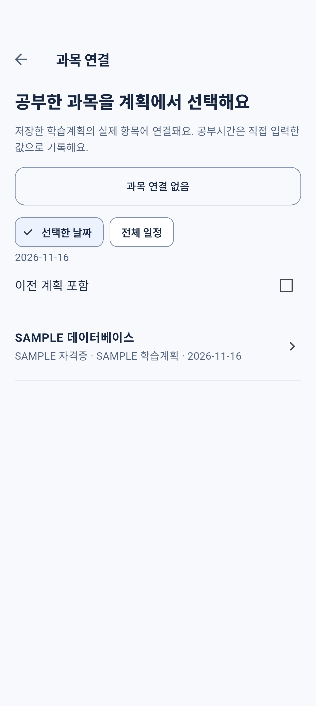
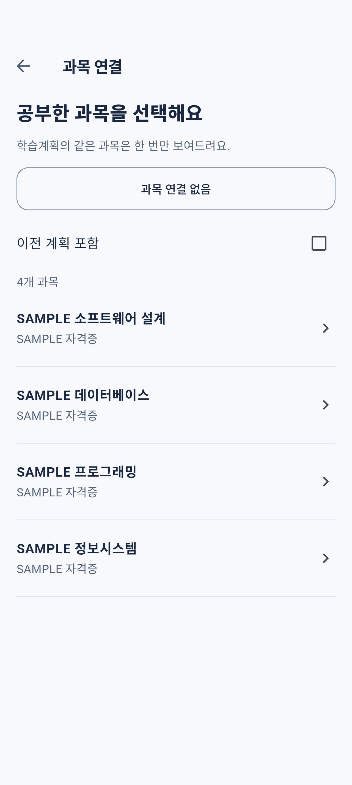
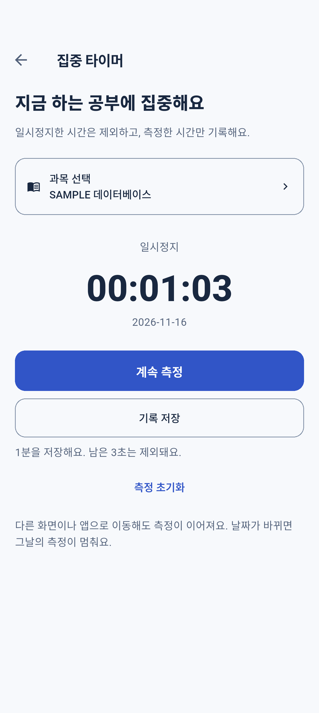
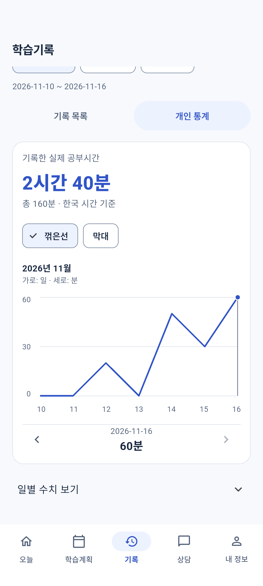
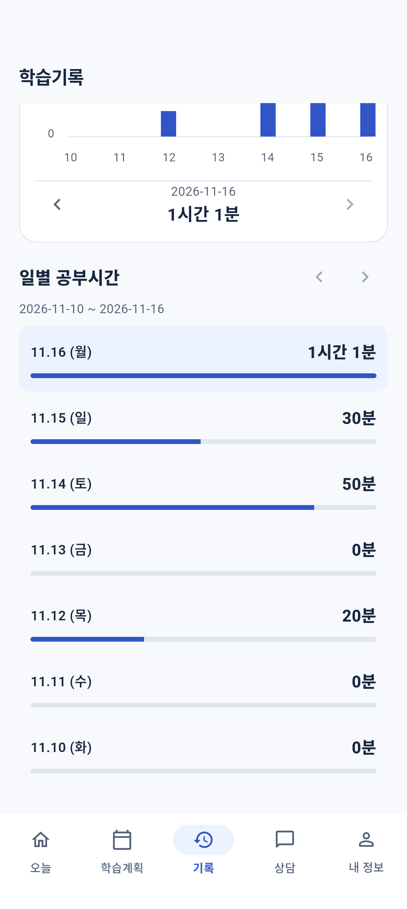
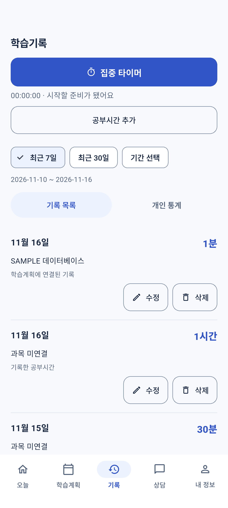

# 집중 타이머·과목 선택·일별 통계 개선

2026-11-16 · 앱 변경만 적용. 팀 프로젝트 전체/기존 학습기록 Java/API/DB/인증은 보존한다.

## 사용자 화면

- **기록 → 집중 타이머**: 과목 선택(선택 사항), 시작·일시정지·계속 측정·기록 저장. 측정한 정수 분을 기존 API로 저장하며 저장한 기록의 수정/삭제를 유지한다.1분 미만은 저장하지 않고 남은 초를 안내한다.
- 다른 화면/앱으로 이동해도 측정하며 서버·계정별로 기기에 복원 상태를 보관한다. 날짜 경계에서 그날의 측정을 멈추고 저장/초기화 후 새로 시작한다. 앱이 켜진 동안은 단조 증가 시계를, 재시작 복원은 저장된 UTC 시점을 사용한다. 복원 때 시각이 뒤로 바뀌면 측정을 멈추고 안내한다.
- 저장 응답이 불확실하면 같은 POST를 자동 반복하지 않는다. 목록을 끝까지 확인한 뒤 **저장된 기록 확인** 또는 **기록 없음 · 측정 유지**를 고른다. 후자는 측정값을 보존하며 다시 저장은 사용자가 직접 한다. 네트워크 결과 불명 상태에서 서버의 향후 커밋까지 확정할 수 없으므로 재저장 전 중복 기록 확인을 안내한다.
- 과목은 날짜별 반복을 제거하고 한 번만 표시한다. 등록된 과목 ID를 우선 사용하며 ID가 없으면 자격증+저장된 과목명을 구분한다. 다른 자격증이나 이름을 알 수 없는 항목을 임의로 합치지 않는다. 기존 연결 ID를 우선 보존하고 새 선택은 공부 날짜에 가까운 실제 계획 항목으로 연결한다. 날짜별 선택/전체 일정 버튼을 제거했다.
- 통계의 ‘한국 시간 기준’ 기술 문구를 제거했다. 내부 날짜 기준·timezone 검증은 그대로다. 일별 표는 날짜·요일과 ‘1시간20분’ 형태를 정렬하며 비교 막대와7일 이동을 제공한다. 기존 기간·꺾은선/막대 그래프·실제 합계는 유지한다. 비교 막대는 기간 내 실제 시간의 상대 길이이며 완료율이 아니다.

## 실제와 모의 검증

| 구분 | 결과·증거 |
| --- | --- |
| 실제 Android + 실제 API | 격리 MariaDB의 SAMPLE 계정/계획64항목을 조회해 과목4개 표시. 실제1분 이상 측정, Android HOME으로20초 이동·복귀, 일시정지, POST1회, 저장 기록과 통계에1분 반영.8개 확인·6화면. `android-result.json`, `android.log` |
| 실제 기존 HTTP 계약 | 변경 없는 Spring Boot 바이너리로 기존 저장/수정/소유권/400·401·403·409·일별 합계12개 확인. `http-result.json`. Java 소스가 이전에 검증한 복사본과 같을 때만 격리 서버를 실행함 |
| 실제 Postman | 기존 읽기 전용2요청·8검사 통과. `postman.log`. `--no-report-events -r cli` 사용. CLI의 클라우드 로그인 안내와 별개로 exit0이며 로그인/게시 안 함 |
| 모의 API·Flutter 단위/화면 | 전체186개 통과. 타이머 모델11개·타이머 화면15개, 과목 묶음4개, 일별 표/그래프 및 기존 입력·복원·수정·삭제·응답 유실 회귀 포함. `flutter-all.log`, `review-green.log` |
| 정적 검사 | `flutter analyze --no-pub`: 경고/오류0. `analyze.log` |
| 접근성/크기 | 너비320/360/412 × 글자150%/200%에서 타이머·과목·저장과 기존 기록·통계·입력·키보드 검사 통과. 실제 TalkBack 음성은 미검증 |

실제 사용자 계정에 검증용 쓰기를 하지 않았다. 실제 API 검사는 별도 포트·별도 MariaDB 데이터 폴더와 합성 계정만 사용한다. 검증이 끝나면 해당 서버와 임시 인증정보를 정리하며 일반 개발 서버8080은 유지한다.

## 발견·수정한 문제

- 독립 읽기 전용 최종 검토1회에서 Important3건을 찾았다. 일시적 저장소 읽기 오류 뒤 복구 플래그가 남는 문제, 미저장 측정값을 확인 버튼이 지우는 문제, 폐기된 인스턴스의 늦은 응답이 같은 계정의 새 타이머 상태를 덮는 문제다.
- 각각 실패를 재현한 뒤 수정했다. `restore-retry-red.log`, `review-red.log` → `review-green.log`(26개)와 전체186개 통과. 재검토를 요청하지 않고 구현자가 해당 검사로 수정 검증했다. 다른 Critical/Minor 지적이나 보류한 검토 지적은 없다.
- 손상된 실행 상태의 주기 콜백 오류도 실패→수정→통과로 검사했다(`corrupt-red.log`, `timer-green.log`와 최종 전체 검사).
- 실제 이미지에서 일별 비교 막대의 높이가0인 문제를 찾았다. 높이5·너비 양수 검사를 추가해 실패를 확인하고 수정했다(`daily-bar-red.log`, `daily-bar-green.log`).
- 첫 Android 자동화는 스크린샷 콜백이 테스트 종료 후 실행되어 HOME 이동 전에33초만 측정했다. 실행 중 신호를 감지해 HOME/복귀를 수행하도록 검사 도구를 수정하고1분 이상 측정 흐름을 재실행했다(`android-first-attempt.log`, 최종 `android.log`). 이 실패는 타이머 측정 오류가 아니다.
- 초기 회귀 검사의 버튼 종류/선택된 칩/지연 생성 행 위치는 새 UI에 맞춰 전체 버튼을 찾아 스크롤하도록 조정했다. 입력·수정·삭제·인증의 기존 검증 의미는 유지했다.

## 화면 · 격리 API 합성 데이터

| 변경 전 과목 선택 | 변경 후4과목 | 타이머 |
| --- | --- | --- |
|  |  |  |

| 변경 전 통계 | 변경 후 일별 표 | 타이머 저장 기록 |
| --- | --- | --- |
|  |  |  |

변경 전 이미지는 직전 학습기록 작업의 격리 API 캡처를 원본 그대로 복사했다. 변경 후는 이번 Android 캡처다. 시험/과목/기록은 모두 SAMPLE이며 실제 개인 데이터가 아니다.

## 변경 파일

| 앱 운영 코드 | 이유 |
| --- | --- |
| `lib/data/study_timer.dart`(신규) | 측정·일시정지·기기 복원·날짜 경계·저장 중 상태·이전 인스턴스 쓰기 차단 |
| `lib/data/study_models.dart` | 실제 과목 항목의 중복 제거·기기 상태 직렬화 |
| `lib/ui/study_timer_screen.dart`(신규) | 타이머·과목 선택·저장·오류·초기화 UI |
| `lib/ui/study_records.dart` | 타이머 진입·수명 관리·목록/통계 재조회·불확실한 저장 결과 확인 |
| `lib/ui/study_task_picker.dart` | 전체 페이지를 읽어 중복 없는 과목 목록, 날짜 필터 제거 |
| `lib/ui/study_chart.dart` | 읽기 쉬운 일별 표/요일/시간·분/비교 막대/7일 이동 |
| `lib/ui/study_record_form.dart` | 불필요한 시간대 기술 문구 제거 |

나머지 변경은 해당 검사, 격리 검증 도구/데이터, README와 검증 문서다. 기존 `lib/data/api.dart`·세션·로그인/보안 저장소·계획 초안 처리·기존 저장 키·의존성/버전·Android 설정·실행 스크립트는 그대로다. 타이머는 기존 저장 추상화에 별도 키만 사용한다.

## 백엔드·계약 보존과 한계

작업 전 해시와 비교해 **팀 프로젝트202개**, **이전 백엔드66개** 전부 동일하다. 이번에는 기존 학습기록 Java6개도 수정하지 않았다. 새 테이블/SQL/마이그레이션/API/팀원 TODO 변경0. 상세 목록은 `scope-result.json`이다.

기존 API 총6개 목록은 [API 계약](../api-contract.md)에 그대로 있다. 측정값을 사용자가 확인해 기존 POST에 저장하므로 DB 입력 방식은 기존 MANUAL이며 수정·삭제할 수 있다. 새 TIMER 전용 입력 방식, 서버 시작/종료 시각, 여러 기기의 타이머 동기화나 영속 중복 방지는 추가하지 않았다. 이들을 별도 관리하려면 기존6파일 범위를 넘어서는 계약·DB 검토가 필요하며 이번 구현에서 제외한다.

물리 휴대폰의 화면 잠금/절전·OEM 백그라운드 정책, 실제 TalkBack, release 서명/스토어 배포, 여러 기기의 측정 동기화는 미검증이다. 기기 날짜/시각이 조작된 복원 시간을 서버가 검증하는 기능은 기존 API에 없다. 복원·기기 쓰기 실패·저장 중 종료는 모의 상태 검사로 확인했으며 실제 Android 프로세스를 강제 종료하는 검사는 하지 않았다.

이번은 앱 코드 변경으로 Java/React를 다시 빌드하거나 원래 별도 React 서비스의 Build.ps1/웹 테스트를 실행하지 않았다. 해당 소스는 해시로 보존을 확인했고 기존 팀 바이너리와 실제 API 연동을 검증했다.

## 갱신과 APK

새 일반 APK: `C:/Users/std66/Documents/ChatGPT/PASS_FACE _ TEST/passpace_mobile/build/app/outputs/flutter-apk/app-debug.apk`.

`flutter build apk --debug --no-pub --target=lib/main.dart` 성공. 테스트 진입점/계정 마커5개 미포함 확인 후 에뮬레이터에 업데이트 설치했다. 핫 리로드 성공·런타임 오류0. 결과는 `apk-result.json`, `runtime-result.json`에 기록했다. 격리 서버/인증정보 정리와 기존 개발 서버8080 실행 상태는 `server-result.json`으로 확인했다. 휴대폰은 이 APK로 업데이트한다. 개발 서버는 기존 **서버 켜기.cmd**를 사용한다.
