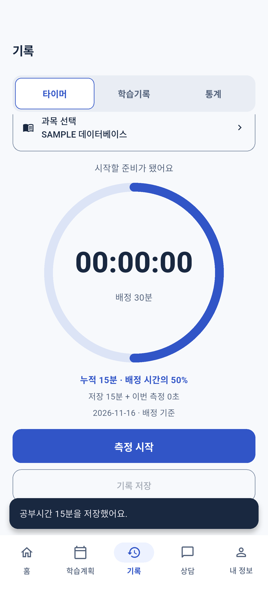
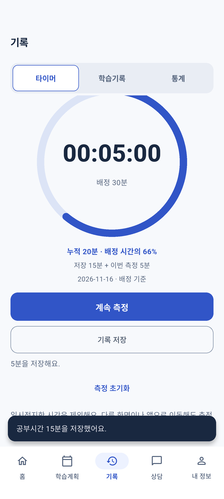
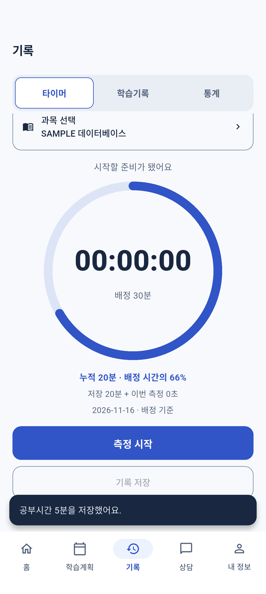

# 저장 기록과 재측정 누적 원형

2026-11-16 · 앱 UI와 관련 검사만 변경했다. 백엔드·DB·API·측정/저장 모델·인증·알림·버전은 유지했다.

## 동작과 집계 기준

원의 진행은 **선택 날짜의 같은 과목 저장 분 + 이번 미저장 측정**이다. 중앙 시계와 저장 요청은 이번 측정 그대로다. 예: 배정30분, 저장15분에 새로5분을 재면 누적20분/약66%다.5분을 추가 저장한 뒤 같은 과목을 다시 선택하면 시계0초·저장20분/약66%를 표시한다. 원만100%에 머물며 측정이나 저장을 자동 종료하지 않는다.

기존 studySessions(date,date)의 모든 페이지를 읽고 sessionId별로 한 번만 집계한다. 값이 같아도 ID가 다른 정상 기록은 모두 합친다. 날짜 밖·과목 미연결 기록을 더하지 않는다. 안정적인 subjectId를 우선하고 ID가 없는 경우 실제 taskId의 시험/과목 메타데이터로 확인한다. 같은 이름의 다른 시험을 합치지 않는다. 필요한 과거 연결 정보만 내부 조회하며 **과목 선택은 계속 ACTIVE만 제공**한다. 이전 계획 선택 옵션을 다시 추가하지 않았다.

페이지 일부가 실패하거나 연결을 확인할 수 없으면 부분 합계를 정상 값처럼 그리지 않는다. **학습 시간 다시 불러오기**로 다시 읽는다. 과거 날짜 타이머를 복원했다면 그 날짜의 기록과 배정을 사용하고 날짜를 표시한다. 매초 새 요청을 보내지 않고 선택·날짜·재진입·앱 복귀·저장 상태 전환 때 갱신한다.

## 저장 중복 방지

- 저장 요청/결과 확인 중에는 추가 기록 조회를 중단하고 마지막 표시를 유지한다. 응답 대기 전에 시작했던 조회도 현재 저장 상태를 확인해 폐기한다.
- 저장이 확정된 상태는 이번 측정을 합계에 다시 더하지 않는다. 기존 모델이 측정값을 초기화하고, 재선택 때 저장된 분을 새로 읽는다.
- 4xx 거부 등으로 한 프레임 안에 저장 전 상태로 돌아와도, 폐기했던 조회를 다음 갱신에서 재시도한다.
- 기록 수정·삭제 뒤 타이머로 돌아오면 최신 저장 합계를 읽는다. 기록 값/연결 ID를 앱이 임의로 변경하지 않는다.

기존 API에는 영속 요청 키가 없다. 응답 유실 후 늦게 커밋된 기록을 클라이언트가 완벽하게 식별하는 보장을 추가한 것은 아니다. 기존의 결과 확인/재전송 주의 절차는 유지하며, 날짜·분이 같다는 이유로 서로 다른 저장 기록을 임의 삭제/병합하지 않는다.

## 화면 · 실제 Android의 모의 데이터

|15분 저장 후 새 측정0초|저장15분 + 새 측정5분|다시 저장 후 시계0초·누적20분|
|---|---|---|
||||

이전 단일 측정 원형은 [직전 화면](../timer-ring/screenshots/sample-timer-half.png)에서 비교할 수 있다. 위 캡처는 실제 에뮬레이터의 같은 앱 화면을 MockClient·메모리 저장소·합성15/5분 측정으로 실행한 것이다. 실제15분/5분을 기다려 측정했다거나 실제 사용자 기록을 저장한 결과로 보고하지 않는다. 촬영 때 스크롤 위치가 다르다.

## 실제·모의·미검증

|구분|확인 결과와 증거|
|---|---|
|Flutter 모의 API·단위·위젯|전체224개 통과. 새13개가 누적·페이지41건/3페이지·ID 중복/정상 반복·다른 날짜/시험/미연결 제외·과거 연결·저장/확정/재측정·불명확한 결과·늦은 응답·수정/삭제·시작 버튼·빠른 거부 재조회 등을 확인. flutter-all.log, green.log, review-red.log|
|실제 Android + 모의 API|15분 저장→재선택 시 시계0/원50%→5분 재측정 누적20분→재저장/재선택 시 시계0/원약66% 확인. 모의 POST2회, 모의 저장 합계20분,4개 확인·3장 캡처. sample-android-result.json, sample-android.log|
|정적 검사|flutter analyze --no-pub 문제0. analyze.log|
|일반 앱|lib/main.dart APK 빌드/업데이트·핫 리로드 성공·런타임 오류0. 일반 앱은 로그인 화면이며 실 계정 로그인 후의 쓰기 흐름은 미검증. apk-result.json/runtime-result.json|
|미검증|물리 휴대폰·실제 로그인 계정의 기록 쓰기·장시간 실측·TalkBack 음성·잠금/절전·release/스토어 배포|

Android 검증에서 알림 권한은 테스트 에뮬레이터에 사전 허용했다. OS 권한 팝업 동작을 이번에 검증한 것으로 보고하지 않는다. 실제 API/DB에 테스트 쓰기를 수행하지 않았다. 기존 Java/React/Postman 쓰기 검사는 이번 UI 변경의 검사로 다시 실행한 것이 아니다.

## 최종 검토와 변경 파일

독립 읽기 전용 최종 검토1회에서 Important1개를 발견했다. 저장 중 live 가드가 응답을 폐기했지만 저장→거부가 한 프레임 안에 끝나면 다시 조회하지 않는 문제였다. 실패를 재현(review-red.log)하고 재조회 필요 상태를 유지하도록 수정한 뒤 전체224개 및 Android 흐름을 다시 통과했다. Critical/Minor 지적은 없고 재검토를 요청하지 않았다. 최초 누적3개는 실패(red.log) 후 구현했고 나머지 사례를 보강했다.

|파일|변경 이유|
|---|---|
|lib/ui/study_subject_history.dart (신규)|저장 기록 모든 페이지·ID 중복 제거·과목 연결 검증·저장 분 집계|
|lib/ui/study_timer_progress.dart|누적 표시·저장 상태 보호·늦은 조회 폐기/재시도·저장/이번 측정 구분|
|lib/ui/study_timer_screen.dart|읽기 전용 저장 상태 전달 및 저장 중 실시간 조회 가드|
|test/study_timer_cumulative_test.dart (신규)|새13개 회귀|
|test/study_timer_progress_test.dart|검사용 상태/활성 인자·재조회 문구 갱신|
|integration_test/timer_cumulative_preview_test.dart, test_driver/timer_cumulative_driver.dart (신규)|격리 모의 저장/재측정의 Android 실행/화면|
|README.md, docs/verification.md, 본 폴더|사용법·계획·검증·전후 화면·작업 전 해시와 최종 비교|

작업 전 해시와 비교해 팀202개·이전 백엔드66개 전부 동일하다. 앱의 API/모델/측정·저장·인증/초안/Android·알림/패키지/환경 버전 및 다른 팀원 코드도 동일하다. 결과는 scope-result.json에 기록했다. 계획 배정/서버 통계/DB 구조를 수정하지 않았다.

## APK

일반 APK: C:/Users/std66/Documents/ChatGPT/PASS_FACE _ TEST/passpace_mobile/build/app/outputs/flutter-apk/app-debug.apk

모의 검증 뒤 일반 진입점으로 다시 빌드하고 테스트 마커8개 미포함을 확인해 에뮬레이터에 업데이트했다. 핫 리로드·런타임 오류0 확인 후 일반 앱을 유지한다. 현재 로그인 화면이며 로그인 후 기록에서 사용할 수 있다. 휴대폰은 같은 APK를 설치한다. 서버는 기존 실행기를 사용하며 이 UI 때문에 재시작하거나 DB를 변경할 필요가 없다. 영속 요청 키나 원자적인 여러 페이지 스냅샷 보장은 기존 API 밖의 별도 계약 사항으로 유지한다.
