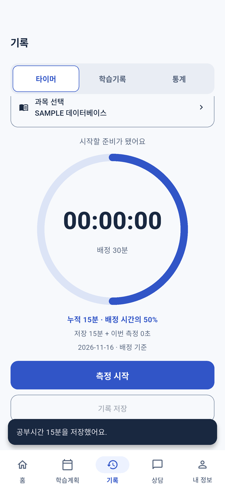
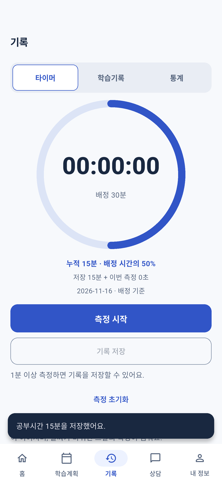
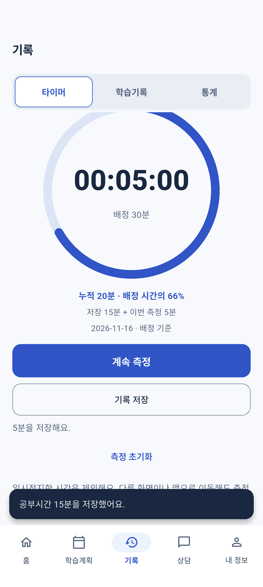

# 저장 후 과목 유지·바로 재측정

2026-11-16 · Flutter 앱 UI와 관련 검사·문서만 변경했다. 백엔드·API·DB·다른 팀원 코드는 변경하지 않았다.

## 사용 흐름

**기록 저장 → 같은 과목·같은 타이머 화면·시계0 → 측정 시작**으로 이어진다. 저장된 같은 날짜/과목 시간은 원에 계속 반영하며, 새 측정분만 다음 저장 요청에 사용한다. 자동으로 새 측정을 시작하지 않는다. 사용자가 직접 **측정 초기화**하면 과목도 기존처럼 초기화한다.

저장하는 동안 다른 탭을 보고 있었다면 그 탭을 유지한다. 알림을 눌러 입력 화면 위에 연 타이머도 저장 후 닫지 않으므로, 뒤로 가면 원래 입력 화면으로 돌아간다. 저장 결과가 불명확할 때는 기존 기록 확인 절차를 유지하며, 명시적으로 저장을 확인한 뒤 같은 과목으로 다음 측정을 준비한다. 확정된 저장의 기기 정리 실패도 **새 측정 준비** 재시도 후 같은 선택을 복원한다.

기존 complete/reset은 수정하지 않고, 성공적으로 초기화된 타이머에 기존 choose()로 선택만 복원한다. 같은 계정·사용 가능한 idle0 타이머·빈 선택을 확인하며, 로그아웃 뒤 늦은 응답으로 이전 과목을 복원하지 않는다. 서버의 배정·과목 연결 검증은 그대로다. 계획이 교체되었을 때의 기존 재선택 안내도 유지한다. 패키지·저장 키·저장 형식·측정 방식·알림 코드를 변경하지 않았다.

## 화면 비교

|이전 검증의 재선택 후 화면|현재 저장 직후 · 선택 없이 바로 재측정 가능|현재 새5분 측정 · 저장분15분과 합산|
|---|---|---|
||||

[두 번째 저장 후 시계0·누적20분](screenshots/sample-after-second-save.png). 캡처는 실제 Android 에뮬레이터에서 모의 API·메모리 저장소·합성 측정으로 실행한 화면이다. 사진마다 스크롤 위치가 다르며, 과목을 다시 고르지 않았다는 사실은 이미지 모양만으로 판단하지 않고 아래 자동 조작·상태 검사로 확인했다.

## 검증

|구분|결과와 증거|
|---|---|
|모의 · Flutter 전체|232개 통과. 새8개는 저장→직접 재측정→재저장, 선택의 기기 복원, 저장 중 탭 이동, 로그아웃 뒤 응답, 기기 정리 실패 재시도, 응답 유실의 명시적 기록 확인, 수동 초기화, 입력 위 알림 타이머, 프레임 사이 빠른 초기화의 누적 갱신을 확인한다. red.log/green.log/flutter-all.log|
|정적 검사|flutter analyze --no-pub 문제0. analyze.log|
|실제 Android + 모의 API|기존 Pixel_9_Pro AVD를 실행해 15분 저장→같은 타이머/과목/시계0/원50%→과목 선택 없이 측정 시작→합성5분/누적20분→재저장 후 같은 과목/시계0/누적20분을 확인했다.4개 확인·모의 POST2회·화면3장. sample-android-result.json/sample-android.log|
|실제 일반 앱|lib/main.dart APK 빌드·에뮬레이터 업데이트·실행·핫 리로드 성공. 런타임 오류0. 검증용 마커10개가 일반 APK에 없음을 확인. apk-build.log/apk-result.json/runtime-result.json|
|읽기 전용 최종 검토|독립 검토1회, Critical/Important/Minor 지적0. review.md|
|미검증|물리 휴대폰 설치·실 계정 로그인 후 기록 쓰기·장시간 실측·TalkBack·잠금/절전·release/스토어 배포|

실제15분/5분을 기다린 측정이나 실제 API/DB 저장 결과로 보고하지 않는다. Android 테스트는 알림 권한을 사전 허용했고 실제 권한 팝업은 이번 미검증이다. 일반 앱의 실제 로그인 후 저장 흐름, 기존 Java/React/Postman 실행 검사는 이번 UI 변경에서 다시 수행하지 않았다. 실제 사용자 계정·개인 기록에 테스트 쓰기를 하지 않았다.

## 변경 파일과 보존 범위

|파일|이유|
|---|---|
|lib/ui/study_timer_screen.dart|확정 저장·기기 정리 재시도 후 같은 계정의 선택 복원, 폐기된 자식 화면의 늦은 응답 처리|
|lib/ui/study_records.dart|저장 후 목록 강제 이동 제거, 입력 위 알림 타이머 유지, 명시적 저장 확인 후 선택 복원|
|lib/ui/study_timer_progress.dart|시계가0으로 내려갈 때 같은 과목의 누적 저장 시간 재조회|
|test/study_timer_keep_subject_test.dart (신규)|새8개 회귀 검사|
|integration_test/timer_keep_subject_preview_test.dart, test_driver/timer_keep_subject_driver.dart (신규)|과목 재선택 없는 연속 측정·저장 Android 검증/화면|
|README.md, docs/verification.md, 본 폴더|사용법·계획·작업 전후 해시·실행 증거|

작업 전 scope-before.json의 팀 프로젝트202개·이전 백엔드66개와 최종 해시가 모두 동일하다. 앱의 data/API/모델/인증·저장소/시간 측정/Android/알림/설정/패키지·환경 버전 등 비대상 파일도 동일하다. 새 파일을 포함해 허용 경로 밖의 추가·삭제·변경이 없음을 scope-result.json으로 확인한다. 기존 사용자 변경은 보존했다.

## 갱신과 APK

일반 APK: C:/Users/std66/Documents/ChatGPT/PASS_FACE _ TEST/passpace_mobile/build/app/outputs/flutter-apk/app-debug.apk

현재 에뮬레이터에는 갱신했다. 휴대폰은 같은 APK를 업데이트 설치한다. 서버·DB를 이 UI 변경 때문에 재시작하거나 변경할 필요가 없다. 이번 요청을 위해 보류한 백엔드 개선은 없다. 응답 유실의 영속 요청 키·원자적인 여러 페이지 읽기는 기존 API 계약 밖의 별도 사항이며 이번에 추가하지 않았다.
