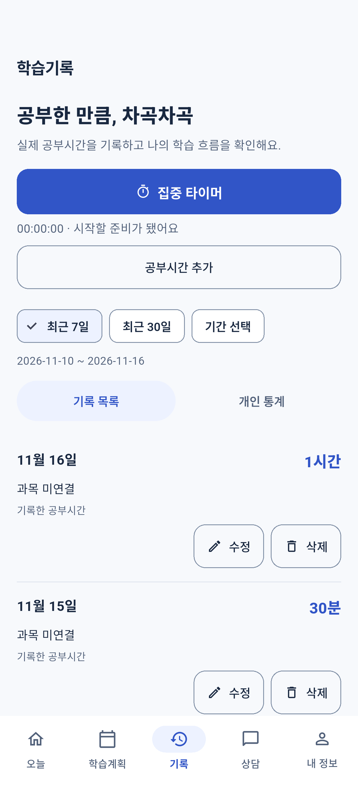
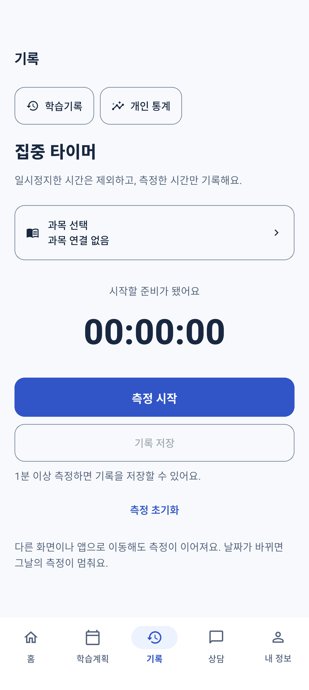
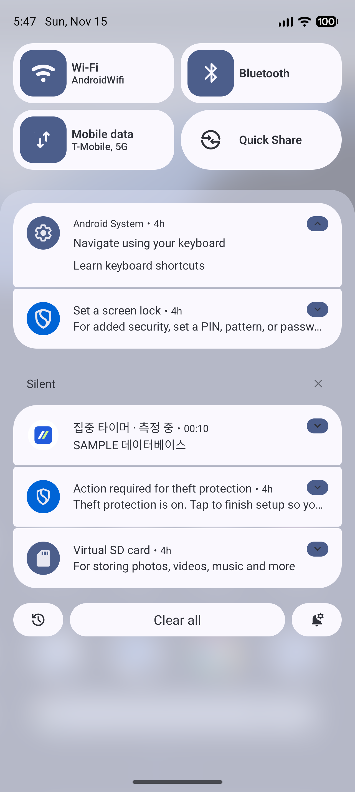
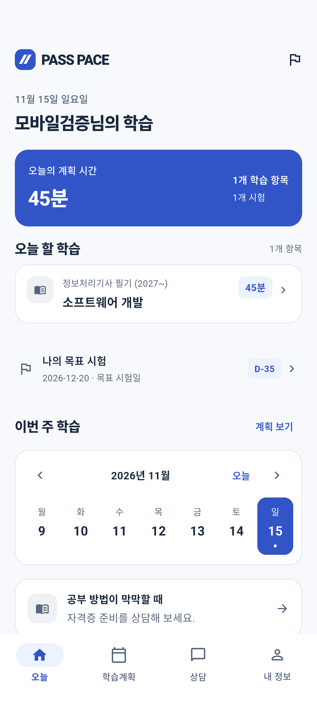
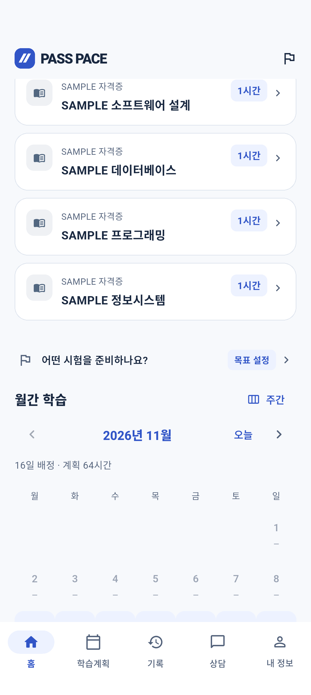
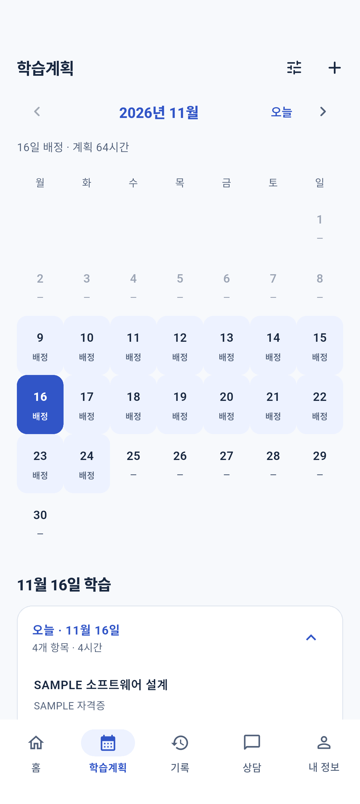

# 기록 탭·진행 알림·월간 달력

2026-11-16 · Flutter 및 앱 내부 Android 코드만 변경했다. 기존 백엔드·API·DB·다른 팀원 코드는 보존했다.

## 바뀐 사용 흐름

- 하단 **기록**을 누르면 타이머를 바로 표시한다. **학습기록**, **개인 통계**를 각각 따로 열고 **타이머**로 돌아온다. 기록 탭 재진입·재선택도 타이머로 이동한다. 미확정 수동 저장 결과가 있으면 기존 확인 절차를 먼저 유지한다.
- 측정 중 Android 알림창에 과목과 자동으로 증가하는 경과 시간을 표시한다. 다른 앱을 사용한 뒤 알림을 누르면 타이머로 돌아온다. 목표·계획 입력을 열어둔 경우 입력을 버리지 않고 위에 타이머를 표시한다. 열린 기록 입력이나 미확정 수동 저장이 있으면 중복 저장을 차단한다.
- 일시정지·저장·초기화·로그아웃 시 진행 알림을 종료한다. 권한 거부 시 앱 측정은 유지하고 알림 설정 동선을 제공한다. 새 앱 클라이언트가 연결되면 이전 전경 서비스를 정리한다. 네이티브에 계정·토큰·API 주소를 전달하지 않는다.
- 홈의 **이번 주 학습 → 월간**으로 달력을 확장한다. 학습계획은 월간을 기본으로 열고 기존 주간·전체 목록도 유지한다. 이전/다음 달 및 월 제목을 누른 날짜 선택으로 계획 기간 안에서 이동한다. 하단 **오늘**을 **홈**으로 바꿨다.
- 빈 날짜에 공부를 추가하거나 시간을 재배정하지 않는다. 계획 시간·측정 시간·저장된 실제 시간의 기존 의미와 기존 저장·수정·삭제·초안 기능을 유지한다.

## 공식 자료와 적용

| 출처 | 직접 확인한 내용 | 이 앱에 적용한 선택 |
| --- | --- | --- |
| [Android 알림 권한](https://developer.android.com/develop/ui/views/notifications/notification-permission) | Android13 이상 일반 알림에 런타임 권한을 사용한다 | 첫 측정 때 권한 요청, 거부해도 측정 유지·설정 안내 |
| [전경 서비스 specialUse](https://developer.android.com/develop/background-work/services/fgs/service-types#special-use) | 다른 서비스 유형에 맞지 않는 유효 사용 사례는 특별 용도 유형과 설명을 선언한다. 스토어 제출 시 검토 대상이다 | 사용자 시작 집중 측정의 진행 알림을 앱 내부 서비스로 구현하고 설명 선언. 스토어 승인 완료로 주장하지 않음 |
| [Notification.Builder chronometer](https://developer.android.com/reference/android/app/Notification.Builder#setUsesChronometer(boolean)) | 시스템 알림에 경과 시간 표시를 제공한다 | 매초 Flutter에서 알림을 다시 만들지 않고 시스템 경과 시간 사용 |

별도 알림 플러그인·패키지·환경 버전을 추가하지 않았다. 월간 전환과 화면 분리는 사용자 요청을 기존 컴포넌트에 적용한 설계이며, 공식 가이드의 의무 요건으로 표현하지 않는다.

## 실제·모의·미검증

| 구분 | 결과 | 증거 |
| --- | --- | --- |
| 실제 Android + 격리 API | 직접 타이머 진입,64개 계획 항목→4과목, 다른 앱에서 알림을 눌러 복귀, 실제1분 측정/POST1회, 기록·통계 분리, 홈 월간/다음 달, 계획 월간 기본, 기록 재진입 등9개 통과 | [android-result.json](android-result.json), android.log |
| 실제 Android 네이티브 | 전경 서비스·알림 표시·chronometer 표시·알림 클릭·일시정지 후 서비스 종료5개 모두 통과 | 같은 결과 파일의 nativeChecks |
| 실제 기존 HTTP | 별도 MariaDB와 원본 Spring Boot 바이너리로 기존 저장·수정·소유권·400/401/403/409·일별 합계12개 확인 | [http-result.json](http-result.json) |
| 실제 Postman | 기존 읽기 전용2요청·8assertion 통과. exit0, 외부 게시/로그인 없음 | postman.log |
| 모의 API·단위·위젯 | 전체195개 통과. 입력/복원/수정/삭제/응답 유실·계정 전환·권한 거부·늦은 응답과 기존 작은 화면/큰 글자/키보드 회귀 포함 | flutter-all.log |
| 정적 검사 | flutter analyze --no-pub 문제0 | analyze.log |
| 일반 실행 APK | lib/main.dart 빌드·에뮬레이터 업데이트·핫 리로드 성공, 런타임 오류0 | [apk-result.json](apk-result.json), [runtime-result.json](runtime-result.json) |

실제 데이터 쓰기는 임시 MariaDB·별도 포트의 SAMPLE 계정에서만 수행했다. 일반 개발 DB/사용자 계정에는 테스트 쓰기를 하지 않았다. 원본 Java6파일이 기존 격리 복사본과 같은지 확인한 뒤 그 바이너리를 사용했다. Java/React 소스 변경이 없으므로 이 작업에서 기존 루트 Build.ps1·React 테스트나 Java 전체 테스트를 다시 실행한 것으로 보고하지 않는다.

알림 권한은 **검증 에뮬레이터에서 사전 허용**했다. 실제 OS 권한 팝업의 허용/거부 조작은 미검증이며, 거부·설정·계정 교체·오래된 권한 응답 차단은 MethodChannel 모의 검사로 확인했다. 물리 휴대폰 연결0대. 물리 기기의 잠금/절전·OEM 배터리 정책·강제 종료·실제 만료 인증으로 콜드 실행했을 때 서비스 정리·TalkBack 음성·release 서명·Play 특별 용도 심사는 별도 검증 사항이다. 날짜 경계·로그아웃·저장 실패는 기존 모델/화면 및 브리지 검사와 소스 확인 범위를 실제 Android 조작과 구분한다.

## 전후 화면

| 변경 전 기록 탭 | 변경 후 타이머 직접 진입 | 다른 앱 사용 중 실제 알림창 |
| --- | --- | --- |
|  |  |  |

| 기존 홈 주간 구성 | 홈 월간 확장 | 학습계획 월간 기본 |
| --- | --- | --- |
|  |  |  |

변경 전 이미지는 이전 작업의 격리 검증 캡처이며, 홈 이미지는 이전 학습계획 통합 시점이다. 변경 후10장과 비교 시 데이터·촬영 위치가 다름에 유의한다. 이번 캡처의 시험/과목/기록은 SAMPLE이다. 홈 달력은 목록 아래에 있어 스크롤로 전체를 볼 수 있다. 시스템 알림창의 날짜는 에뮬레이터 OS 설정이며 앱 학습 날짜의 Asia/Seoul 규칙은 변경하지 않았다.

[중복 없는 과목](screenshots/live-navigation-subjects.png) · [측정 중](screenshots/live-navigation-running.png) · [일시정지](screenshots/live-navigation-paused.png) · [저장 후 목록](screenshots/live-navigation-saved.png) · [분리된 일별 통계](screenshots/live-navigation-daily.png) · [다음 달](screenshots/live-navigation-home-next-month.png)

## 수정 파일

| 운영 코드 | 변경 이유 |
| --- | --- |
| lib/ui/dashboard.dart | 홈 명칭·주/월 전환·기록 탭 진입·계획 월간 기본·공통 선택 날짜 |
| lib/ui/study_records.dart | 타이머/목록/통계 분리·타이머1개 유지·알림 연결·입력 보존·저장 경합 차단 |
| lib/ui/study_timer_screen.dart | 직접 표시와 기록/통계 이동·알림 설정 안내·오버레이 저장 차단 |
| lib/ui/plan_month_calendar.dart | 월 제목 날짜 선택, 기존 월 이동/범위 유지 |
| lib/data/study_timer.dart | 네이티브의 단조 증가 경과 시간과 복귀 시 정렬. 날짜/상한/저장 규칙 유지 |
| lib/data/study_timer_notifications.dart (신규) | 앱 내부 MethodChannel·권한·이전 타이머/계정 응답 차단·소유자별 종료 |
| android/app/src/main/AndroidManifest.xml | 알림·전경 서비스 권한과 비공개 specialUse 서비스 선언 |
| android/app/src/main/kotlin/kr/passpace/mobile/passpace_mobile/MainActivity.kt | 새 브리지 수명·알림 Intent·권한 응답 연결. 기존 관리자 핸들러 원문 보존 |
| 같은 위치의 StudyTimerBridge.kt / StudyTimerService.kt (신규) | 권한/Intent 처리와 진행 알림·단조 증가 시계·날짜 경계·소유권 종료 |
| android/app/src/main/res/drawable/ic_study_timer.xml (신규) | 알림용 단색 시계 아이콘 |

검사: 새 test/timer_navigation_test.dart, test/study_notification_test.dart 및 기존 test/plan_month_calendar_test.dart, study_records_test.dart, study_timer_screen_test.dart, study_timer_test.dart. 실제 검증 도구: integration_test/timer_navigation_live_test.dart, test_driver/timer_navigation_driver.dart, integration_test/support/study_api_fixture.py의 선택적 합성 일정, support/java/NotificationDumpTest.java. 범위 검사 scripts/verify-timer-navigation-scope.py, README 및 본 검증 문서도 갱신했다.

UI Automator의 기본 idle 대기는 계속 갱신되는 시계 때문에 새 XML을 쓰지 못했다. 초기 자동화3회 실패는 알림 표시 실패와 구분한다. 기존 Android SDK의 테스트 도구에서 idle 대기만 없애는 **검증 전용 Java 도우미**로 고친 뒤 실제 흐름을 다시 통과했다. 도우미는 앱 소스/백엔드가 아니며 APK에 포함하지 않았다. 이 테스트 API의 deprecation 경고를 앱 빌드 오류로 간주하지 않는다.

## 최종 검토와 보존 증거

독립 읽기 전용 검토1회에서 Important2개·Minor2개를 발견해 수정했다. 추가 검토를 요청하지 않고 다음 검사로 확인했다.

- 열린 입력 화면이 알림 복귀를 가림 → 입력을 유지하며 타이머 오버레이. 실패 재현 후 회귀 검사 통과.
- 인증 전 콜드 실행에서 서비스 정리가 늦음 → 네이티브 브리지 초기화 때 정리. 소스/Android 컴파일 확인, 실제 만료 인증 콜드 실행은 미검증.
- 비활성 기록 pane의 뒤로가기 가로채기 → 활성 pane만 처리. 전체 회귀 통과.
- 미래/종료 계획에서 홈의 달력 선택과 본문 날짜 불일치 → 공통 유효 날짜 사용. 실패 재현 후 회귀 검사 통과.

검토 회귀 로그는 review-navigation-red.log → review-navigation-green.log(4개). 새 동선·알림·월 제목 이동도 각각 초기 실패와 통과 로그를 남겼다. 모델의 네이티브 정렬 검사와 네이티브 정리 코드는 별도 RED를 실행했다고 주장하지 않는다.

**팀 프로젝트202개·이전 백엔드66개 모두 작업 전후 SHA-256 동일**. 기존 학습기록 Java6개, API 총6개, DB/SQL/설정/스크립트/웹 전체도 그대로다. [scope-result.json](scope-result.json)에 범위별 결과와 앱 변경 목록이 있다. 기존 MainActivity 관리자 처리 코드는 신규 연결 부분만 제거하면 원본 해시와 같은지 별도로 확인했다([admin-preservation.json](admin-preservation.json)). pubspec.yaml/pubspec.lock·Gradle·API/세션·보안 저장소·계획 초안·기존 저장 키·환경 버전을 유지했다.

## 갱신·남은 범위

일반 APK: C:/Users/std66/Documents/ChatGPT/PASS_FACE _ TEST/passpace_mobile/build/app/outputs/flutter-apk/app-debug.apk

flutter build apk --debug --no-pub --target=lib/main.dart 성공 후 에뮬레이터에 업데이트했다. 테스트 진입점·인증정보 마커 및 Java 도우미가 APK에 없는지 검사했다. 핫 리로드 후 오류0, 연결 도우미만 종료하고 일반 앱 실행은 유지했다. 휴대폰은 같은 APK를 설치하고 처음 측정할 때 알림을 허용한다. 연결 서버는 기존 **서버 켜기.cmd**로 실행한다.

격리 검증 서버를 종료하고 임시 인증정보를 제거했다. 기존 개발 서버8080은 실행 중이며 [server-result.json](server-result.json)에 상태를 기록했다. 디버그 APK이며 정식 서명/스토어 배포를 수행하지 않았다.

새 백엔드 기능은 필요하지 않아 이번에 추가하지 않았다. 서버 타이머 상태·여러 기기 동기화·서버 검증 시작/종료 시점·영속 중복 방지는 기존 API에 없는 별도 계약/DB 검토 사항으로 유지한다. 기존6개 API 목록은 [API 계약](../api-contract.md)에 있다.
