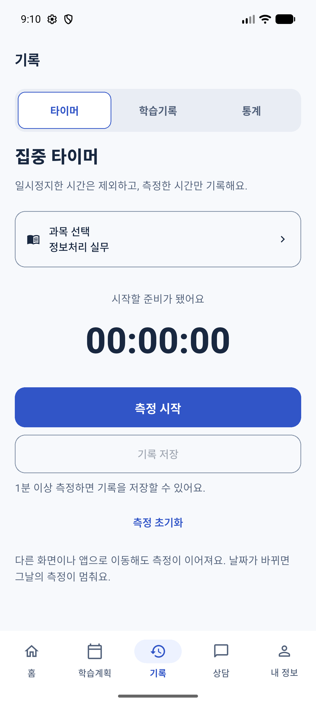
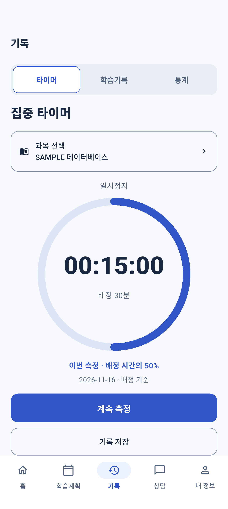
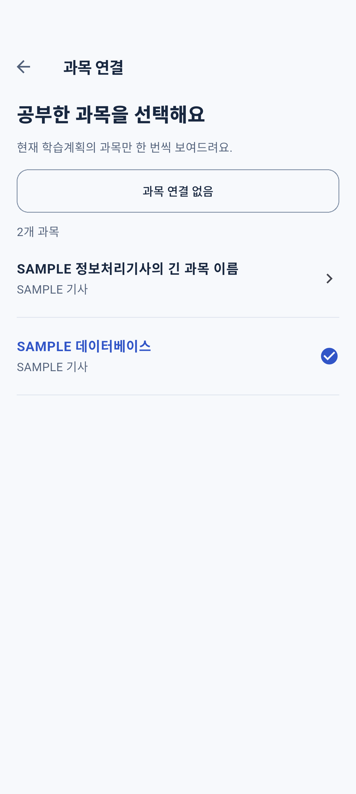

# 과목별 배정 시간 원형 타이머

2026-11-16 · 앱 화면만 수정했다. 백엔드·DB·기존 API·시간 측정/저장·인증·알림·패키지/환경 버전은 유지한다.

## 동작

- 숫자 타이머 둘레를 큰 파란 원으로 표시한다. **이번 측정 시간 / 선택 과목의 해당 날짜 배정 시간**만큼 채우며,30분 배정에15분 측정이면50%다. 기존 저장 기록을 합친 하루 완료율이 아니다.
- 배정 도달 후에도 실제 측정은 계속되고 원만100%에 머문다. 기존 일시정지·수동 저장·수정/삭제·기기 복원·정수 분 저장 규칙은 유지한다. 자동 종료·자동 저장·계획 재배정을 추가하지 않았다.
- 원 크기는 화면 높이에 맞춰220~300dp 범위에서 조정하고 좁은 너비에도 맞춘다. 설명/간격을 정리해 일반 글자360×820에서 측정 시작을 스크롤 없이 누를 수 있게 했다. 큰 글자는 스크롤해 기존 버튼에 접근한다.
- 과목 선택은 기존 API의 기본값 includeReplaced=false를 사용해 ACTIVE 계획 과목만 표시한다. **이전 계획 포함** 체크박스와 이전 계획 표시를 제거했다. 날짜별 중복 없는 과목 선택은 유지한다. 과거 기록·기기에 복원한 연결을 임의로 지우거나 바꾸지 않는다.

## 배정 정보의 근거

과목 선택 API는 taskId/planId/버전·과목·시험·날짜만 제공하며 배정 분은 없다. 기존 saved()의 planId/versionNo 및 날짜·시험·과목·minutes를 읽어 선택 과목과 연결했다. 소유권은 기존 서버 API가 검증하며 앱은 계획 ID·버전과 실제 ACTIVE 연결, 이름/시험의 일치 여부를 추가로 확인한다.

같은 날짜·시험·과목에 여러 배정이 있으면 이미 서버가 배정한 분을 합쳐 표시한다. 다른 날짜의 시간을 가져오지 않는다. 동일 이름에 여러 과목 ID가 섞이면 임의로 합치지 않는다. 과목 미선택, 학습계획 없음, 그 날짜의 배정 없음, 계획 교체/불일치·과목 구분 불가, 조회 실패는 각각 빈 원과 안내로 표시한다. 연결 오류는 **배정 시간 다시 불러오기**로 조회만 재시도하며 기존 측정은 유지한다.

배정 조회는 선택/날짜/다시 진입/앱 복귀 때 수행한다. 경과 시간 업데이트마다 API를 부르지 않는다. 이전 요청 번호·API 인스턴스·현재 계정 상태를 확인해 늦은 응답을 폐기한다. 기존 API/모델·계산 서비스를 수정하거나 새 계약을 만들지 않았다.

## 참고한 공식 자료

| 출처 | 확인한 사실 | 적용 |
| --- | --- | --- |
| [Flutter CircularProgressIndicator](https://api.flutter.dev/flutter/material/CircularProgressIndicator-class.html) | 확정된 진행 값은0~1의 non-null value로 표시하며 접근성 이름/값과 선 두께를 지정할 수 있다 | 항상 확정 값으로 그려 빈 배정을 무한 로딩으로 표현하지 않음. numeric % 접근성 값, 파란 원·회색 배경·배정 시간/비율 텍스트 |
| [Flutter disableAnimationsOf](https://api.flutter.dev/flutter/widgets/MediaQuery/disableAnimationsOf.html) | 시스템 애니메이션 줄이기 설정을 읽고 변경을 반영한다 | 짧은200ms 채움 전환을 설정에 따라 생략 |

원형 배치와 크기는 사용자 요청에 따른 이 앱의 설계 선택이다. 특정 앱의 화면이나 브랜드를 복제하지 않았다.

## 전후 화면

| 이전 숫자 타이머 | 원형 타이머:30분 중15분 | 현재 과목만 선택 |
| --- | --- | --- |
|  |  |  |

변경 전은 직전 작업의 일반 앱 캡처다. 변경 후 위 두 장은 **실제 Android 에뮬레이터에서 실행한 모의 API/합성 측정 예시**다. SAMPLE 계획·과목과 메모리 저장소만 사용했으며 실제15분을 측정했다거나 실제 개인 통계가50%라고 주장하지 않는다. 날짜/과목/스크롤 위치는 전후가 다르다.

## 실제·모의·미검증

| 구분 | 결과·증거 |
| --- | --- |
| 모의 API·Flutter 단위/화면 | 전체211개 통과(기존195+새16). 날짜/시험/과목 배정 일치·여러 배정 합계·0/절반/상한·빈 날짜·미선택·교체된 계획·모호한 ID·오류/재시도·늦은 권한 응답·현재 과목 제한·첫 화면 시작 버튼·320/360/412×150~200% 글자 포함. flutter-all.log, green.log |
| 실제 Android + 모의 API | 15/30분 절반 원·일시정지 복원 시간·현재 과목만·이전 계획 옵션 없음4개 확인, 화면2장. HTTP 클라이언트는 MockClient이고 기기 세션/초안은 메모리 전용. 실 API 쓰기0. sample-android-result.json, sample-android.log |
| 정적 | flutter analyze --no-pub 문제0. analyze.log |
| 일반 앱 실행 | lib/main.dart 일반 APK 빌드·에뮬레이터 업데이트·핫 리로드 성공, 실행 오류0. 일반 앱의 로그인 화면 실행 확인. 로그인 후 실제 배정 조회/장시간 측정은 이번 미검증. apk-result.json, runtime-result.json |
| 미검증 | 물리 휴대폰·TalkBack 실제 음성·OS 권한 팝업·절전/잠금·release 서명/스토어 배포·실제 배정이 있는 과목으로 장시간 측정·실 API 쓰기 |

기존 기록 저장/수정/삭제·불확실한 저장 결과 확인·계정 전환·입력/복원·타이머 날짜 경계·알림 브리지의 회귀 검사는 유지한다. 이번에 실제 Java/React/Postman 쓰기 검사를 다시 수행한 것으로 보고하지 않는다. 백엔드/API 변경이 없으며 보호 파일 해시 비교로 변경 범위를 확인했다.

## 발견·검증한 사항

- 최초 원형 검사에서 기능 미구현 실패를 확인한 뒤 구현했다(red.log → green.log). 새16개 중 화면 시작 버튼 검사는 별도 실패(primary-action-red.log)를 재현해 원 크기/여백을 조정하고 통과했다.
- 초기 Android 예시 실행은 SAMPLE 목록의 제네릭 타입 오류로 배정 응답을 만들지 못했다. 독립 Dart 예시에서 같은 _TypeError를 재현한 뒤 **검증 데이터만** Json 목록으로 정리했다. 앱은 조회 실패 안내를 표시했으며 원형 비율이나 백엔드 오류가 아니었다. 비동기 조회/채움 완료 대기와 스크린샷 보고서 병합도 검증 도구에 반영하고 최종 실행을 통과했다. 초기 로그는 sample-android-first/second/diagnostic.log다.
- 독립 읽기 전용 최종 검토1회에서 신규3개 운영 파일과 검사에 Critical/Important/Minor 지적이 없었다. 재검토를 요청하지 않았다.

## 수정 파일

| 파일 | 이유 |
| --- | --- |
| lib/ui/study_timer_progress.dart (신규) | 기존 배정 읽기·계획/연결/날짜 확인·원형 채움·빈 값/오류·접근성 |
| lib/ui/study_timer_screen.dart | 숫자 시계 위치에 원형 표시 연결·화면 높이별 크기·간격 정리. 측정/저장 콜백 유지 |
| lib/ui/study_task_picker.dart | 이전 계획 옵션 제거·ACTIVE만 요청/검증·기존 과목 중복 제거 유지 |
| test/study_timer_progress_test.dart (신규) | 새16개 검사 |
| integration_test/timer_ring_preview_test.dart, test_driver/timer_ring_driver.dart (신규) | 실제 Android에서 모의 데이터로 화면/동작 확인·캡처 |
| README.md, docs/verification.md, 본 폴더 | 사용법·계획·전후 화면·검증·작업 전 상태와 해시 비교 |

scope-before.json 대비 **팀202개·이전 백엔드66개 전체가 동일**하다. 앱의 기존 데이터/API/측정 모델/인증/초안/Android/의존성/버전·나머지 팀원 코드도 동일하다. 최종 목록은 scope-result.json이다. 기존 사용자 변경은 보존했다.

## APK와 갱신

일반 APK: C:/Users/std66/Documents/ChatGPT/PASS_FACE _ TEST/passpace_mobile/build/app/outputs/flutter-apk/app-debug.apk

모의 검증 후 flutter build apk --debug --no-pub --target=lib/main.dart로 다시 빌드했다. 일반 APK의 테스트 진입점·SAMPLE_TIMER_RING_PREVIEW/검증 계정 등6개 마커 미포함을 확인하고 에뮬레이터에 업데이트했다. 현재 일반 앱은 로그인 화면이며, 로그인 후 기록에서 사용할 수 있다. 휴대폰은 같은 APK로 업데이트한다. 기존 서버 켜기.cmd를 사용하며 서버 재시작·DB 변경은 이 UI에 필요하지 않다. 백엔드 변경이 필요한 추가 개선은 이번 요청에 없다.
