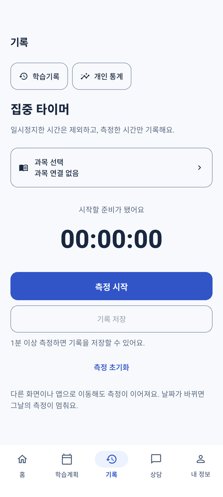
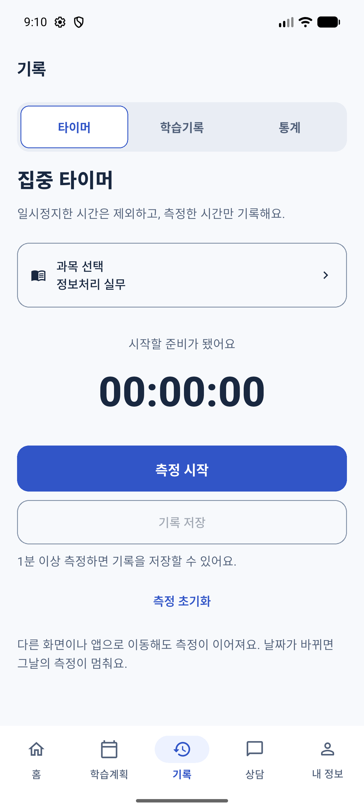
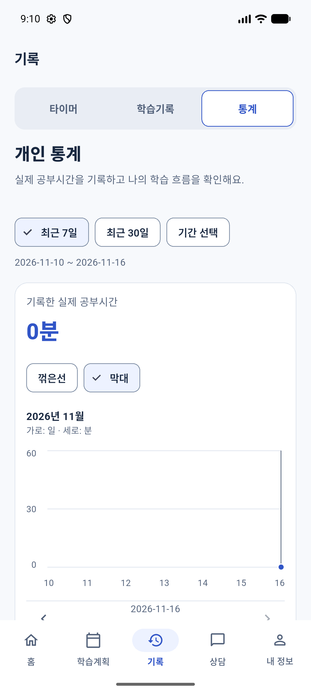
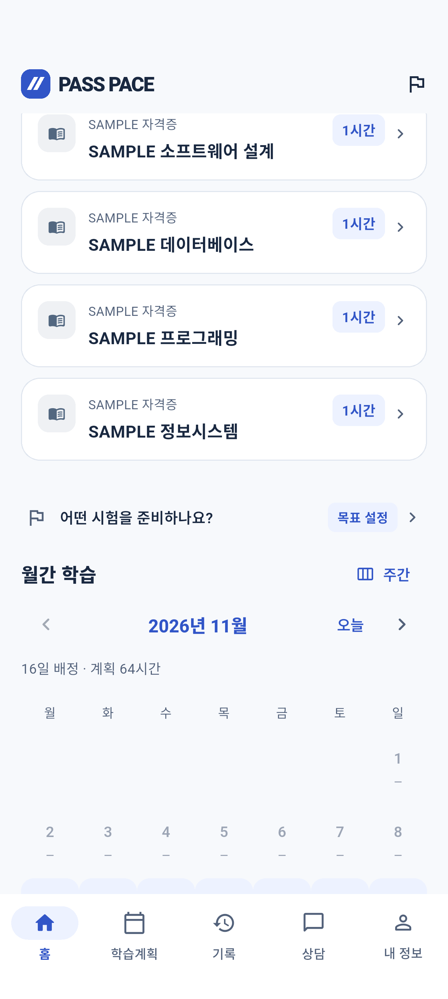
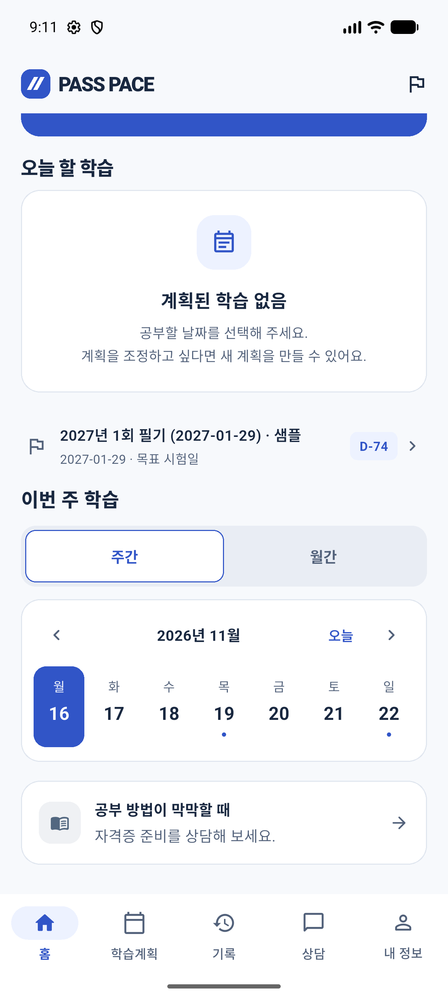
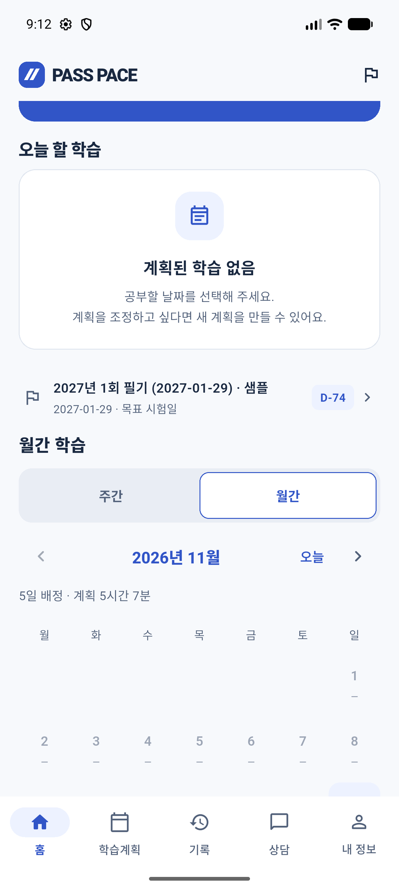

# 홈·기록 화면 선택 바 개선

2026-11-16 · 앱 화면만 변경. 기존 상태·저장·타이머·알림·날짜·과목 연결 기능은 유지한다.

## 적용

- 홈은 **주간·월간**을 함께 표시하며 선택한 쪽에 흰 배경과 파란 테두리를 표시한다. 날짜/기간과 서버 배정은 기존 로직을 사용한다.
- 기록의 **타이머·학습기록·통계**는 한 선택 바에서 전환한다. 선택 바는 본문 스크롤 밖에 두어 긴 통계에서도 즉시 타이머로 전환한다. 중복 이동 버튼·통계 아래의 기록 목록 링크·돌아가기 화살표를 제거했다.
- 타이머 인스턴스·측정·기기 복원·날짜 경계·저장 결과 확인·인증/소유권 동작을 유지한다. 화면 전환은 기존 showTimer/openRecords 콜백을 사용한다. 미확정 수동 기록의 기존 전환 차단도 유지한다.
- 최소48dp와 큰 글자 줄바꿈을 사용한다. 선택 강조160ms는 시스템 애니메이션 줄이기 설정에서 생략한다. 공통 스타일 전체를 변경하지 않고 새 선택 바에만 적용했다.

## 이전 계획 포함의 목적

과거 공부시간을 입력하거나 기존 기록의 과목을 수정할 때, 새 계획으로 교체된 옛 계획의 과목도 찾기 위한 옵션이다. 꺼져 있으면 기존 API의 ACTIVE 계획만 읽고 켜면 includeReplaced=true로 조회한다. 과목 중복 제거와 기록의 연결 ID 보존 규칙은 그대로다. 필요성을 질문한 요청에 설명했으며, 옵션 삭제 요청으로 간주해 기존 기능을 없애지 않았다. 관련 study_task_picker.dart·API·조회 조건을 이번에 수정하지 않았다.

## 전후 화면

| 이전 타이머의 별도 이동 버튼 | 개선 후 고정 선택 바 | 통계에서 바로 전환 |
| --- | --- | --- |
|  |  |  |

| 이전 홈의 월간 버튼 | 주간 선택 | 월간 선택 |
| --- | --- | --- |
|  |  |  |

변경 전은 직전 작업의 격리 SAMPLE 데이터 캡처이며, 변경 후는 실행 중인 일반 앱을 읽기 전용으로 조작해 촬영했다. 데이터와 스크롤 위치가 서로 다르다. 이름/계정·인증정보가 없는 부분을 촬영했으며 실제 기록 추가/수정/삭제를 수행하지 않았다.

## 검사와 한계

| 구분 | 결과·증거 |
| --- | --- |
| 모의 API·단위·위젯 | 기존 전체195개 통과. 기간·기록 저장/수정/삭제·초안·불확실한 저장·계정 전환·달력 회귀 유지. 새 선택 바는 기존 이동 검사를 키로 갱신했으며, 통계 스크롤 중 위치 고정·실행 중 타이머 인스턴스 유지·전환 시 POST 없음·주/월 왕복을 기존 검사에 추가했다. flutter-all.log |
| 작은 화면/큰 글자 | 기존320·360·412 및150~200% 회귀 검사 통과. 선택 바는 텍스트가 줄바꿈해도 버튼 높이를 맞춘다 |
| 정적 | flutter analyze --no-pub 문제0. analyze.log |
| 실제 에뮬레이터 | 기록→통계→타이머, 홈 주간→월간, 실제 읽기 전용 조회/선택 상태와 화면4장 확인. 저장 쓰기 없음 |
| 실행 갱신 | 핫 리로드 및 위젯 구조 변경 후 핫 리스타트 성공, 런타임 오류0. 일반 lib/main.dart APK 빌드/업데이트 결과는 apk-result.json과 runtime-result.json |
| 독립 검토 | 읽기 전용 최종 검토1회. 신규 UI에 Critical/Important/Minor 지적 없음. 재검토 요청 없음 |

초기 제한 실행 환경에서 SDK 시작이 멈춰 해당 검사 프로세스를 중단하고 기존 Windows Flutter 환경으로 실행했다. 패키지/SDK 버전이나 파일을 바꾸지 않았다. 실행 앱에 Flutter Driver 확장이 없어 해당 도구 조작은 사용하지 않았으며, 정상 앱의 읽기 전용 동작은 Android SDK의 실제 화면/접근성 요소로 확인했다.

이번은 UI 변경이므로 실제 API 쓰기 검사·Postman/Java/React 전체 검사를 다시 수행한 것으로 보고하지 않는다. 물리 휴대폰·TalkBack 음성·OS 권한 팝업·잠금/절전·release/스토어 배포는 이번 미검증이다. 이전 작업의 알림 검사 결과와 이번 화면 검사를 구분한다.

## 수정 파일과 범위

| 파일 | 이유 |
| --- | --- |
| lib/ui/view_switch.dart (신규) | 선택 상태·동일 폭/높이·접근성 의미·큰 글자 줄바꿈·짧은 강조 전환 |
| lib/ui/dashboard.dart | 홈 주/월 단일 이동 버튼을 두 선택으로 변경 |
| lib/ui/study_records.dart | 고정된 세 화면 선택 바. 기존 타이머/기록/통계 본문과 콜백 유지 |
| lib/ui/study_timer_screen.dart | 중복 이동 버튼과 미사용 통계 콜백 제거. 불확실한 저장 결과의 기록 확인은 유지 |
| test/study_records_test.dart, study_edit_test.dart, study_actions_test.dart, study_timer_screen_test.dart | 기존 기능 검사의 이동 버튼 찾기를 새 전환 컨트롤 키로 갱신 |
| test/timer_navigation_test.dart | 스크롤 뒤 전환 접근·타이머 유지·주/월 왕복 회귀 보강 |
| README.md, docs/verification.md, 본 폴더 | 사용법·계획·전후 화면·검증과 변경 전 해시 기록 |

팀 프로젝트202개·이전 백엔드66개는 작업 전후 해시가 모두 동일하다. 앱의 Android/데이터/API/세션/보안 저장소/초안/과목 연결/패키지·환경 버전도 동일하다. 결과와 이 작업의 변경 목록은 scope-result.json이다. 기존 다른 사용자 변경을 덮어쓰지 않았다. 이번 UI를 위해 추가로 필요한 백엔드 개선 사항은 없다.

## 갱신

새 일반 APK: C:/Users/std66/Documents/ChatGPT/PASS_FACE _ TEST/passpace_mobile/build/app/outputs/flutter-apk/app-debug.apk

일반 APK 빌드/에뮬레이터 업데이트 설치 성공. 테스트 진입점/인증정보 마커4개 미포함 확인 후 일반 앱에 핫 리로드하고 런타임 오류0을 확인했다. 휴대폰은 기존 앱에 업데이트 설치하면 된다. 서버는 기존 서버 켜기.cmd를 사용하며, 서버/DB 변경이나 재시작은 이번 UI에 필요하지 않다. 타이머·알림 기능은 기존 버전 그대로다.
